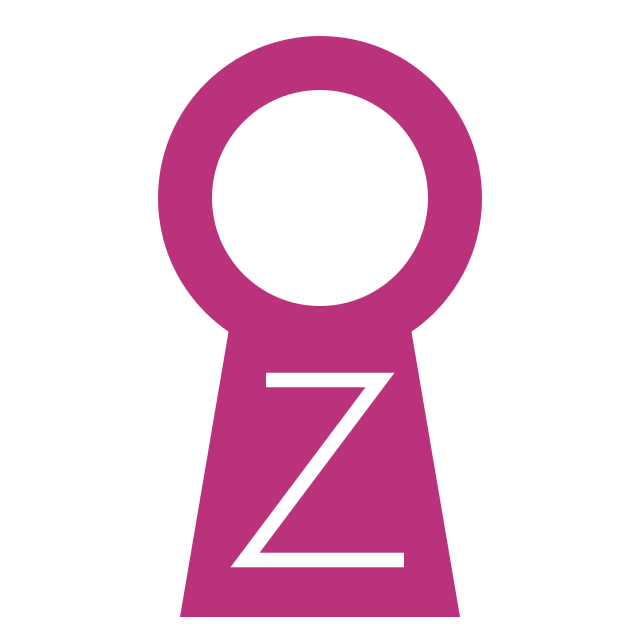

<p align="center"></p>

<h1 align="center">OZ — Oz Protocol</h1>

<p align="center">
  An anonymous peer-to-peer network that runs in a browser tab or a small desktop app.<br>
  Onion routing over WebRTC, anonymous boards, and large-file sharing with no central server.
</p>

<p align="center">
  <a href="https://github.com/jkfujinami/Oz/releases/latest">Download</a> ·
  <a href="https://ozzy-web.pages.dev/">Web version</a> ·
  <a href="README.ja.md">日本語</a>
</p>

> [!WARNING]
> OZ is experimental and has not been audited. Do not rely on it where your safety is at stake.

## What it does

- **Onion routing inside the browser.** Each message goes through two hops (a Guard picked from your WebRTC neighbours, then a middle node picked from the Guard's neighbours) under layered encryption. Traffic is cut into fixed 1,200-byte cells and mixed with constant cover traffic, so your Guard cannot tell when you actually send something, and the middle node never learns your IP.
- **Everyone relays.** There are no volunteer exit operators. An open tab carries cells for others the way they carry yours.
- **Posts don't start at you.** After the middle node, a post takes a Dandelion++-style random walk before it is broadcast.
- **Anonymous boards.** Public boards and private boards shared by a code. Each thread uses its own signing key, so your posts in different threads cannot be linked.
- **Large files with no storage server (Ozzy).** Files are encrypted, Reed-Solomon coded (any 16 of 32 shards rebuild a stripe) and spread across free public file hosts. Uploads and downloads are done by middle nodes on your circuits through Cloudflare Workers that participants run themselves, so neither the hosts nor the relays see your IP.
- **Abuse resistance without accounts.** Node identities cost an Argon2id proof of work, and every post carries an Equi-X proof of work scaled to its size.
- **Local data stays sealed.** History and board keys are encrypted with your passphrase. There is a lock and a panic-wipe button.

## What it does not protect against

- A global passive adversary that watches most of the internet.
- Your Guard colluding with one of your middle nodes. This is the same two-hop limit Tor has. Trusted Guards (below) reduce the risk.
- Your Guard and the tracker see your IP, so they know you use OZ. The tracker only introduces WebRTC peers.
- Cloudflare sits under every relay Worker. It sees middle nodes and file-host URLs, not you, but it is one company.
- File hosts can delete files. Half the shards of each stripe can disappear and the file still rebuilds.

## Download

Installers for macOS, Windows and Linux are on the [Releases](https://github.com/jkfujinami/Oz/releases) page, with a `SHA256SUMS.txt` to check them against.

The builds are **not code-signed**, because signing ties an Apple or Microsoft developer account to a real identity.

- **macOS:** right-click OZ in Applications and choose **Open** the first time.
- **Windows:** SmartScreen warns about an unknown publisher. Choose **More info → Run anyway**.
- **Linux:** `chmod +x OZ-*.AppImage` and run it.

The desktop app can also run a **Guard** for other people (Settings → この端末の Guard). It runs in the background under its own identity and keeps running while the window is locked.

## Trusted Guards

Your first hop sees your IP, so OZ prefers Guards from a list signed by the maintainer. The maintainer key is built into the app from [`trust/trust.json`](trust/trust.json). Until a signed list exists, clients fall back to choosing Guards from the open network. See [`trust/README.md`](trust/README.md) for how a Guard gets listed.

## Repository layout

| Path | Contents |
| --- | --- |
| `packages/core` | Protocol: identity, WebRTC mesh, onion routing, boards, Ozzy file layer |
| `packages/ui` | React UI shared by the web and desktop apps |
| `packages/tracker` | WebSocket tracker for peer introduction (Node and Deno Deploy) |
| `packages/r2-worker` | The Cloudflare Worker each participant deploys as a relay |
| `apps/desktop` | Electron app |
| `apps/guard` | Headless Guard node |
| `web` | Static web build (Next.js) |
| `trust` | Maintainer key and signed Guard lists embedded at build time |

## Building

Requires Node.js 22.

```sh
npm ci
npm run build:core

# Desktop app (installers end up in apps/desktop/release/)
npm run build:desktop
cd apps/desktop && npx electron-builder --mac --win --linux --publish never

# Web app (static files in web/out/)
npm run build:web

# Tests
npm test
```

Releases are built on the maintainer's machine with [`scripts/release.sh`](scripts/release.sh) and published to [jkfujinami/Oz](https://github.com/jkfujinami/Oz/releases).

## Contributing and security

See [CONTRIBUTING.md](CONTRIBUTING.md). Report vulnerabilities privately as described in [SECURITY.md](SECURITY.md), not in public issues.

## License

[MIT](LICENSE). OZ is provided as is, without warranty. You are responsible for how you use it and for complying with the laws that apply to you.
